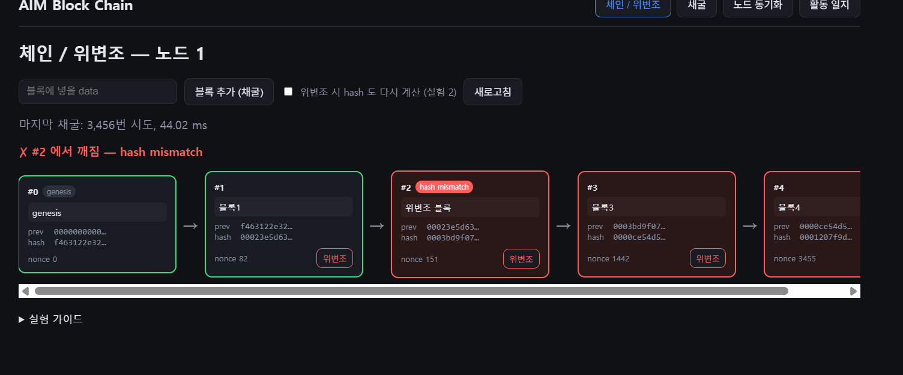
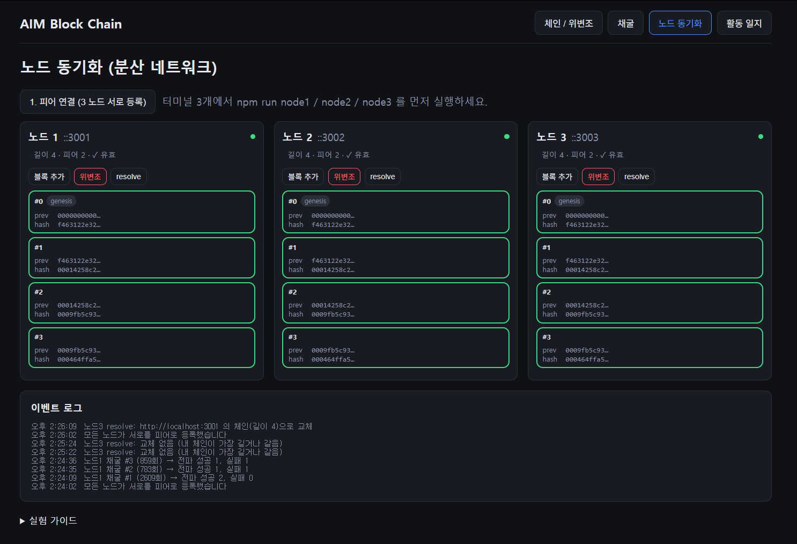

# AIM Block Chain — 블록체인 백엔드 적성 검증 미니 프로젝트

대학 진로탐색 공모전 활동의 일부로, **"블록체인 백엔드 개발이 나의 적성인가"** 라는 진로 가설을
직접 백엔드 작업을 해보며 검증하기 위한 프로젝트입니다. 완성도 높은 블록체인이 목표가 아니라,
작업 과정에서 기록한 **활동 일지 데이터**가 핵심 산출물입니다.

## 검증하려는 가설

- 초기 가설 (1주차, 확신도 7/10): 분산 시스템 구조에 흥미가 있으므로 블록체인 백엔드에 적합할 것이다.
- 수정 가설 (2주차, 확신도 4/10): 기획·프론트엔드 역량을 바탕으로 블록체인 서비스 분야에 적합하며,
  백엔드(분산 시스템) 적합성은 직접 경험으로 확인이 필요하다.
- 남은 질문
  1. 백엔드에 대한 관심은 적성인가, 호기심인가?
  2. 내가 흥미를 느낀 것은 "블록체인 자체"인가, "분산 구조(P2P)"인가?

## 구조

### 폴더

```
AIM-block-chain/
├── server/    A. TypeScript + Express 블록체인 API (포트 3001~3003 으로 여러 노드 실행)
├── web/       B. React + Vite 시각화 (블록 카드, 위변조, 채굴, 노드 동기화) + 활동 일지 대시보드
├── journal/   C. 활동 일지 CLI (입력, CSV 내보내기)
├── data/      activity-log.json (활동 일지 원본 데이터)
└── docs/      review-log.md, findings.md, study-guide.md, commit-guide.md
```

### 전체 구성

```
┌────────────────────────────────────────────────────────────┐
│  브라우저  http://localhost:5173              (web/ React)   │
│  탭: 체인/위변조 │ 채굴 │ 노드 동기화 │ 활동 일지              │
└──────┬──────────────────┬───────────────────┬───────────────┘
       │ fetch            │ fetch             │ fetch
       ▼                  ▼                   ▼
┌─────────────┐    ┌─────────────┐    ┌─────────────┐
│  노드 1      │◀──▶│  노드 2      │◀──▶│  노드 3      │  (server/ Express)
│  :3001      │    │  :3002      │    │  :3003      │  같은 코드를 포트만 다르게 3번 실행
│  chain[]    │    │  chain[]    │    │  chain[]    │  각 노드는 자기 메모리에 체인 보관
└─────────────┘    └─────────────┘    └─────────────┘
       ▲  노드끼리도 HTTP 로 통신 (블록 전파, 체인 조회)

┌────────────────────────────────────────────────────────────┐
│  터미널  npm run log                        (journal/ CLI)  │
│  → data/activity-log.json → 브라우저 "활동 일지" 탭이 읽음     │
└────────────────────────────────────────────────────────────┘
```

- **web**: 화면. 서버에 fetch 만 한다.
- **server**: 블록체인 본체. 상태는 `chain` 배열 하나이고 메모리에만 있다(DB 없음, 재시작 시 초기화). 포트를 바꿔 3번 실행하면 노드 3개가 된다.
- **journal**: 블록체인과 무관한 보고서용 기록 도구.

### 서버 내부

```
HTTP 요청
   │
   ▼
app.ts ── express.json(), cors
   │
   ├─ routes/chain.routes.ts            URL → 함수 연결만 담당
   │     GET  /chain       → chain 배열 응답
   │     POST /blocks      → pow.mineBlock → chain.push → nodes.broadcastBlock
   │     GET  /validate    → chain.validateChain
   │     POST /tamper/:i   → tamper.tamperBlock
   │
   └─ routes/nodes.routes.ts
         POST /nodes/register → nodes.registerPeers
         POST /blocks/receive → nodes.receiveBlock     (다른 노드가 보낸 블록)
         GET  /nodes/resolve  → nodes.resolveConflicts

blockchain/          단일 체인 로직 (1~4단계)
   block.ts    해시 계산, 제네시스/다음 블록 생성
   chain.ts    chain 배열(상태) + 검증
   pow.ts      작업증명(채굴)
   tamper.ts   위변조 실험
network/nodes.ts     노드 간 동기화 로직 (5단계)
```

### 요청 흐름 1: 블록 추가와 전파

```
[브라우저] "블록 추가"  →  POST :3001/blocks {data}
[노드 1]   mineBlock: nonce 를 0부터 올리며 hash 재계산, 앞자리 0 이 difficulty 개가 될 때까지
           chain.push(block)
           broadcastBlock: 피어마다 POST /blocks/receive
              ├─ [노드 2] receiveBlock: index·prevHash·hash·difficulty 검사 후 push
              └─ [노드 3] receiveBlock: 동일
[브라우저] 1.5초마다 세 노드에 GET /chain → 화면 갱신
```

### 요청 흐름 2: 위변조와 복구

```
[브라우저] 노드 2 "위변조"  →  POST :3002/tamper/1 {data:"evil"}
[노드 2]   chain[1].data 변경 (hash 는 그대로) → GET /validate 는 #1 "hash mismatch"

[브라우저] 노드 2 "resolve"  →  GET :3002/nodes/resolve
[노드 2]   피어마다 GET /chain 으로 체인 수집
           validateChain 통과 + (내 것보다 길거나, 내가 깨졌으면 같은 길이 이상) → 통째로 교체
```

### 블록 하나의 형태

```json
{
  "index": 1,
  "timestamp": 1794337431069,
  "data": "hello",
  "prevHash": "f463...6355",
  "hash": "0007...fb47",
  "nonce": 2183
}
```

- `prevHash`: 바로 앞 블록의 hash 를 복사한 값. 이 값이 블록들을 연결한다.
- `hash`: index, timestamp, data, prevHash, nonce 다섯 값을 SHA-256 한 결과. 내용이 바뀌면 달라진다.
- `nonce`: hash 앞자리가 `0` × difficulty 가 되도록 찾은 숫자. 2183 이면 2184번 시도했다는 뜻.

## 단계

| 단계 | 내용 | 일지 구분 |
|---|---|---|
| 1 | 블록 생성 + SHA-256 해시 + prevHash 연결 | 백엔드-블록체인 |
| 2 | 체인 유효성 검증 (깨진 블록 index 반환) | 백엔드-블록체인 |
| 3 | 작업증명 (난이도 조절) | 백엔드-블록체인 |
| 4 | 위변조 시뮬레이션 API | 백엔드-블록체인 |
| 5 | 멀티 노드 + 블록 전파 + 최장 유효 체인 채택 | 백엔드-분산네트워크 |
| 6 | 프론트엔드 시각화 | 프론트엔드 |

## AI 활용 방식 (정직한 기록)

- 0단계 세팅(모노레포, 라우터 뼈대, 일지 도구)은 AI가 작성했다.
- 1~6단계의 핵심 로직은 **AI가 튜터로서 시범 구현**했고, 나는 코드를 분석하고
  [docs/study-guide.md](docs/study-guide.md)의 연습 문제를 직접 풀며 학습했다. 연습 과정에서 작성한 코드는 `study(...)` 커밋으로 구분했다.
- 모든 AI 리뷰와 구분 표시는 [docs/review-log.md](docs/review-log.md)에 누적 기록했다.
- 활동 일지는 "코드 분석 + 연습 문제" 작업 단위로 기록해, 백엔드(블록체인 자료구조 / 분산 네트워크)와 프론트엔드에 대한
  흥미·몰입 데이터를 비교한다.

## 실행 방법

```bash
npm install

# 단일 노드
npm run server            # http://localhost:3001

# 멀티 노드 (터미널 3개)
npm run node1 ; npm run node2 ; npm run node3

# 프론트엔드
npm run web               # http://localhost:5173

# 서버 테스트
npm test -w server

# 활동 일지
npm run log                       # 작업 기록 추가
npm run log -- --confidence       # 주차별 확신도 입력
npm run log -- --list             # 목록
npm run log:csv                   # CSV 내보내기
```

노드 3개 실험 순서: 터미널 3개에서 node1/node2/node3 실행 → `npm run web` → "노드 동기화" 탭 → "피어 연결" 버튼.

## API

| 메서드 | 경로 | 설명 |
|---|---|---|
| GET | /chain | 전체 체인 |
| POST | /blocks | 블록 추가 `{ data, mine? }` |
| GET | /validate | 체인 검증 (깨진 index, 이유). `?difficulty=0` 으로 작업증명 검사 생략 |
| POST | /tamper/:index | 위변조 시뮬레이션 `{ data, recompute? }` |
| GET/PUT | /difficulty | 난이도 조회/변경 |
| POST | /nodes/register | 피어 등록 `{ nodes: [] }` |
| POST | /blocks/receive | 전파된 블록 수신 |
| GET | /nodes/resolve | 합의 (최장 유효 체인 채택) |

## 단계별 결과 스크린샷

- [ ] 1단계: 블록 생성 결과 (`GET /chain`)
- [ ] 2단계: 검증 결과
- [ ] 3단계: 난이도별 채굴 시간
- [x] 4단계: 위변조 후 빨간색 표시 화면

  실험 1 (data 만 변경 → #2 hash mismatch, 연결은 유지)

  

  실험 2 (data 변경 + hash 재계산 → #2 difficulty not met, #2→#3 연결 끊김)

  
- [x] 5단계: 노드 3개 동기화 화면

  노드 3 재시작 후: 체인과 피어 목록이 모두 사라져 resolve 가 "교체 없음"

  

  피어 재등록 후 resolve: 노드 1 의 체인(길이 4)으로 교체되어 동기화 완료

  
- [ ] 활동 일지 대시보드

## 결과

- [docs/review-log.md](docs/review-log.md) — AI 코드 리뷰 누적 기록
- [docs/findings.md](docs/findings.md) — 활동 일지 분석 및 결론
- [docs/study-guide.md](docs/study-guide.md) — 단계별 학습 가이드와 연습 문제
- [docs/commit-guide.md](docs/commit-guide.md) — 커밋 순서
