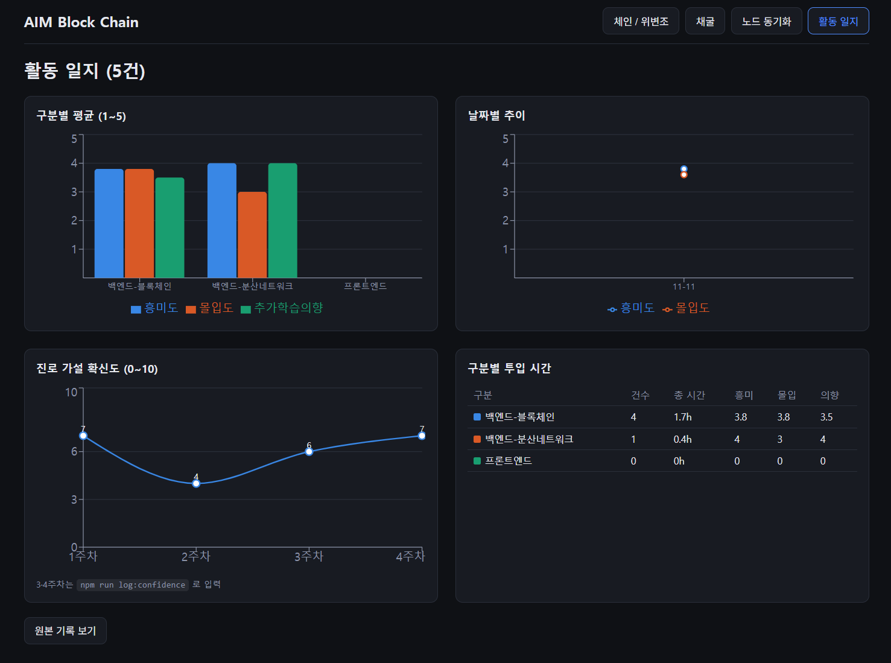
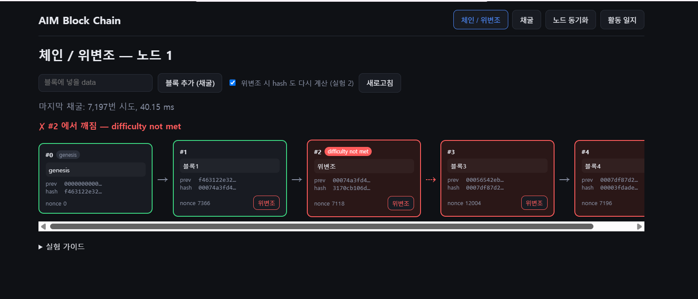
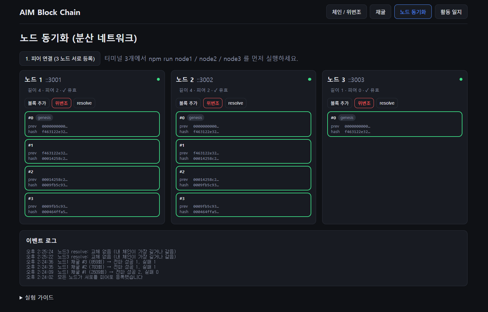

# AIM Block Chain

**"블록체인 백엔드 개발이 나의 적성인가"를 직접 만들어 보며 검증한 진로탐색 프로젝트**

프론트엔드 경험만 있는 소프트웨어전공 3학년이, 중간보고서에서 세운 진로 가설을 검증하기 위해
TypeScript로 블록체인 API 서버와 멀티 노드 동기화를 구현·실험하고, 그 과정의 흥미도·몰입도·막힌 지점을
활동 일지로 기록해 분석했다. 산출물은 블록체인이 아니라 **그 데이터와 결론**이다.

---

## 1. 검증한 가설

| 시점 | 가설 | 확신도 |
|---|---|---|
| 1주차 | 분산 시스템 구조에 흥미가 있으므로 블록체인 백엔드에 적합할 것이다 | 7/10 |
| 2주차 | (AI 반론 + 채용공고 16건 분석 후) 기획·프론트엔드 역량 기반 블록체인 서비스에 적합하며, 백엔드 적합성은 직접 경험으로 확인이 필요하다 | 4/10 |

남은 질문 두 가지를 이 프로젝트로 검증했다.
1. 백엔드에 대한 관심은 적성인가, 호기심인가?
2. 내가 흥미를 느낀 것은 "블록체인 자체"인가, "분산 구조(P2P)"인가?

## 2. 핵심 결과

활동 일지 5건, 확신도 4회 기록 기준. 상세 분석과 판단 근거는 [docs/findings.md](docs/findings.md).

| 구분 | 건수 | 흥미도 | 몰입도 | 추가 학습 의향 |
|---|---|---|---|---|
| 블록체인 자료구조 (해시·검증·작업증명·위변조) | 4 | 3.75 | 3.75 | 3.5 |
| 분산 네트워크 (전파·피어·포크·합의) | 1 | 4 | 3 | 4 |



- **질문 2 (블록체인 vs 분산 구조)**: 흥미의 방향은 분산 네트워크 쪽으로 기울었다. 점수 차이는 척도 한 칸 미만이지만,
  "노드가 서로를 찾는 문제가 블록 자체보다 흥미로웠다"는 자기 보고가 이를 뒷받침한다. 초기 가설의 방향과 일치한다.
- **질문 1 (적성 vs 호기심)**: 현재는 호기심에 가깝다고 판단했다. 코드를 읽고 실험하는 단계까지는 흥미가 유지됐지만,
  직접 구현하는 단계는 밟지 못했다. 막힌 지점은 개념이 아니라 환경·프로세스 수명·측정 방법에 있었다.
- **확신도**: 7 → 4 → 6 → 7. 1주차와 같은 7이지만 근거가 "예상"에서 "경험"으로 바뀌었다.
- **다음 검증**: 가이드 없이 작은 기능을 직접 구현해 보는 것. 구현 독립성이 확인되지 않은 것이 판단을 유보시키는 가장 큰 요인이다.

## 3. 만든 것

| 단계 | 내용 | 일지 구분 |
|---|---|---|
| 1 | 블록 생성, SHA-256 해시, prevHash 연결 | 블록체인 |
| 2 | 체인 검증 (깨진 블록 index·이유 반환) | 블록체인 |
| 3 | 작업증명 (난이도 조절 채굴) | 블록체인 |
| 4 | 위변조 시뮬레이션 (data 변경 / hash 재계산) | 블록체인 |
| 5 | 노드 3개 실행, 블록 전파, 최장 유효 체인 채택 | 분산 네트워크 |
| 도구 | React 시각화 화면, 활동 일지 CLI·대시보드 | 측정 도구 |

실험 화면 두 장. 나머지 단계의 결과는 [docs/study-notes.md](docs/study-notes.md)에 표와 로그로 기록했다.

| 위변조 → 깨진 블록부터 빨간색 | 노드 3개 동기화 (재시작 후 피어 소실) |
|---|---|
|  |  |

구조와 API 상세는 [docs/architecture.md](docs/architecture.md).

## 4. 진행 방식과 AI 활용

- 핵심 로직과 시각화 화면은 **AI가 튜터 역할로 시범 구현**했다. 나는 코드를 분석하고 [docs/study-guide.md](docs/study-guide.md)의
  연습 문제(실험·코드 변경·측정)를 직접 수행하며 [docs/study-notes.md](docs/study-notes.md)에 기록했다.
- 연습 중 AI 코드를 참고한 부분(2-2 findAllBroken)은 [docs/review-log.md](docs/review-log.md)에 구분해 표시했다.
- findings 의 데이터 집계와 초안은 AI가 작성했고, **[판단 필요]로 표시된 5개 항목의 결론은 내가 직접 썼다.**
- 프론트엔드는 측정에서 제외했다. 남은 과제가 스타일 수정 수준이었고, 블록체인 프론트엔드의 핵심(지갑 연결·트랜잭션 서명 등 web3 연동)은
  범위 밖이라 적성을 잴 수 없다고 판단했다.
- 통합 테스트에서 합의 규칙의 허점(위변조된 노드가 길이가 같아 복구되지 않음)을 발견해 수정했다. 경위는 review-log 에 있다.

## 5. 실행

```bash
npm install
npm run node1 ; npm run node2 ; npm run node3   # 터미널 3개
npm run web                                      # http://localhost:5173
npm test -w server                               # 테스트 29개
npm run log                                      # 활동 일지 기록
```

## 6. 문서

| 문서 | 내용 |
|---|---|
| [docs/findings.md](docs/findings.md) | 활동 일지 분석, 데이터의 한계, 최종 판단 |
| [docs/study-notes.md](docs/study-notes.md) | 단계별 실험 기록 (명령, 결과, 배운 점, 막힌 점) |
| [docs/review-log.md](docs/review-log.md) | AI 리뷰와 "AI 구현 / AI 코드 참고" 구분 기록 |
| [docs/study-guide.md](docs/study-guide.md) | 단계별 개념과 연습 문제 |
| [docs/architecture.md](docs/architecture.md) | 시스템 구조, 요청 흐름, API |
| [data/activity-log.json](data/activity-log.json) | 활동 일지 원본 데이터 |
