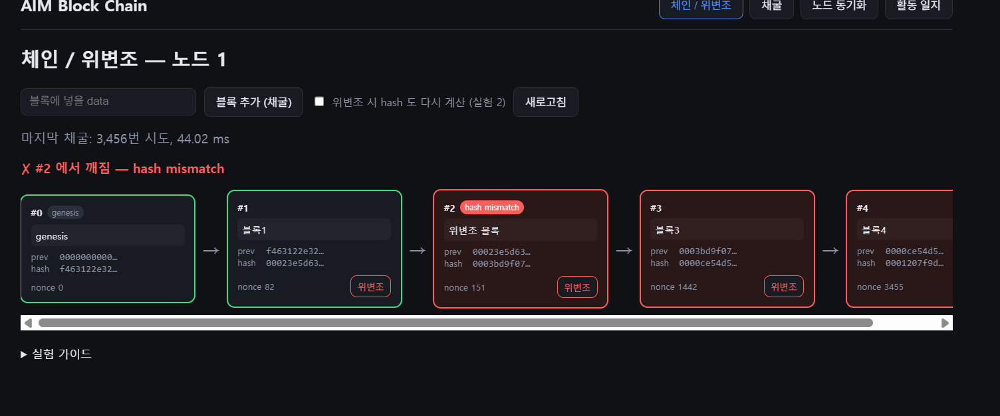
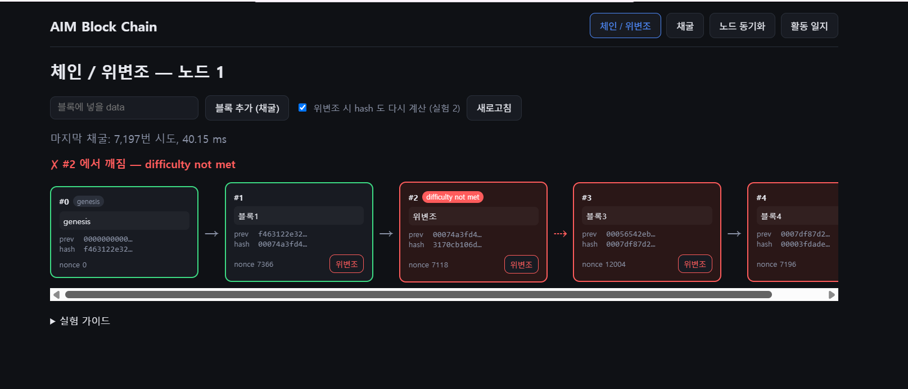

# 연습 문제 풀이 노트

> docs/study-guide.md 의 연습 문제를 풀면서 직접 기록한다.
> 형식: 문제 번호 / 실행한 것 / 결과 / 배운 점 한 줄 / (있다면) 막힌 점

## 1단계

### 1-1

1. 한 것: calculateHash 가 왜 JSON.stringify 를 쓰는지 확인하려고, 값을 그냥 이어 붙이는 방식으로 해시를 만들어 비교해 봤다.

   npx tsx -e "import {createHash as h} from 'node:crypto'; const f=(a,b)=>h('sha256').update(''+a+b).digest('hex'); console.log(f(1,23)===f(12,3))"

2. 결과: true

   (1, 23) 과 (12, 3) 은 분명 다른 입력인데 해시가 같다고 나왔다.

3. 왜 그런가

   1과 23을 그냥 붙이면 "123" 이 되고, 12와 3을 붙여도 "123" 이 된다.
   해시 함수는 붙여진 "123" 이라는 문자열만 받기 때문에, 원래 숫자가 (1, 23) 이었는지 (12, 3) 이었는지 알 방법이 없다.
   해시가 이상한 게 아니라, 해시에 넣기 전에 내가 정보를 잃어버린 것이다.

4. 블록체인에서 이게 왜 문제인가

   블록체인은 "내용이 조금이라도 바뀌면 해시가 달라진다" 는 점을 이용해 조작을 잡아낸다.
   그런데 내용이 다른데도 해시가 같아질 수 있다면, 누군가 블록 내용을 몰래 바꿔도 해시가 그대로라 들키지 않을 수 있다.
   예를 들어 index 1, timestamp 23 인 블록을 index 12, timestamp 3 으로 바꿔도 검증을 통과해 버린다.

5. 해결 방법

   값을 붙일 때 경계를 남겨 주면 된다. 코드의 calculateHash 는 JSON.stringify([index, timestamp, data, prevHash, nonce]) 를 쓰는데,
   이러면 [1,23] 과 [12,3] 처럼 쉼표로 구분되어 서로 다른 문자열이 된다. 띄어쓰기를 해 주는 것과 비슷하다.
   다만 JSON 은 문자열에 따옴표까지 붙이므로, data 안에 쉼표나 공백이 들어 있어도 경계가 헷갈리지 않는다.

6. 배운 점

   테스트 4개는 이어 붙이기 방식으로 바꿔도 통과한다. 테스트가 "다른 입력이 같은 문자열이 되는 경우" 를 검사하지 않기 때문이다.
   테스트는 작성한 것만 검사한다는 걸 처음 체감했다.

### 1-2

1. 한 것: block.ts 의 GENESIS_TIMESTAMP 를 고정 숫자(1_700_000_000_000)에서 Date.now() 로 바꾸고 테스트를 돌려 봤다.

2. 결과: 28개 전부 통과

   "제네시스는 항상 동일하다" 테스트가 깨질 거라고 예상했는데(AI 도 그렇게 예측했다) 통과해서 당황했다.

3. 왜 통과했나

   export const 자리에 있는 Date.now() 는 모듈이 처음 import 될 때 딱 한 번만 실행된다.
   테스트는 프로세스 하나 안에서 돌기 때문에, createGenesisBlock 을 몇 번 불러도 같은 상수를 읽어서 제네시스가 항상 같았다.
   함수 안에서 Date.now() 를 부르는 것과 상수 자리에 넣는 것은 다르게 동작한다는 걸 여기서 알았다.

4. 그러면 문제는 어디서 생기나: 서버를 2개 띄워 봤다

   npm run node1, npm run node2 를 켜고 각각 GET /chain 으로 0번 블록을 비교했다.

   - 노드 1: timestamp 1794371302991, hash 947b99e3…
   - 노드 2: timestamp 1794371302992, hash 1ccf5048…

   두 서버가 켜진 시각이 1ms 차이인데 hash 는 완전히 달랐다. 입력이 조금만 달라도 출력이 전혀 다른 해시의 성질 때문이다.
   즉 프로세스 안에서는 멀쩡한데, 프로세스가 둘 이상이면 "같은 제네시스" 라는 전제가 깨진다.

5. 5단계에서 왜 문제인가

   노드 2가 노드 1의 체인을 받아서 validateChain 을 하면 첫 번째 검사인 "genesis mismatch" 에서 바로 걸린다.
   그러면 노드끼리 체인 동기화(resolve)가 영영 안 된다. 모든 노드가 같은 출발점을 공유해야 한다는 뜻이고,
   비트코인 제네시스 블록이 2009년 날짜로 코드에 박혀 있는 이유가 이것이다.

6. 배운 점

   "테스트 통과" 와 "여러 프로세스(노드)에서 동작" 은 다르다. 분산 시스템 버그는 단위 테스트에 안 잡힐 수 있다.
   그리고 AI 예측이 틀렸는데 직접 실행해서 확인했다. 설명을 그대로 믿지 말고 돌려 봐야 한다는 걸 배웠다.

   실험 후 git checkout 으로 block.ts 를 되돌렸다.

### 1-3

1. 한 것: mine=false 로 블록 3개 추가 후 GET /chain, GET /validate 확인
2. 연결 확인

   GET /chain 결과를 표로 보니 블록마다 prevHash 와 hash 두 칸이 있었다.
   처음엔 둘 다 64자짜리 랜덤 문자열이라 뭐가 뭔지 몰랐는데, 줄을 위아래로 비교하니 규칙이 보였다.

   - 0번(제네시스)의 hash 는 f463122e… 인데, 1번의 prevHash 가 똑같이 f463122e… 였다.
   - 1번의 hash 9321c2bb… 가 2번의 prevHash 에 그대로 들어가 있었다.
   - 2번의 hash 3bcdb115… 가 3번의 prevHash 에 들어가 있었다.

   즉 블록을 새로 만들 때 "바로 앞 블록의 hash 를 복사해서 내 prevHash 칸에 넣는다" 는 것이고,
   코드로는 block.ts 의 createNextBlock 안에 있는 prevHash = prevBlock.hash 한 줄이다.
   이게 "체인" 이라고 부르는 이유다. 블록 자체는 그냥 객체인데, 이 한 칸 때문에 앞 블록과 묶인다.
   앞 블록 내용이 바뀌면 그 hash 가 바뀌고, 다음 블록이 들고 있는 prevHash 와 안 맞게 되니까
   어디서 바뀌었는지 알 수 있다.

3. GET /validate 결과: valid=False, brokenAt=1, reason="difficulty not met"

   연결이 다 맞는데 왜 False 가 나오는지 처음엔 이해가 안 됐다.
   이유는 작업증명 때문이었다. 서버 난이도가 기본 3 이라서, 블록 hash 가 "000" 으로 시작해야 유효한데
   나는 mine=false 로 블록을 추가했기 때문에 채굴(nonce 찾기)을 안 했고, hash 앞자리가 9321…, 3bcd… 처럼
   아무 값이나 나왔다. 그래서 validateChain 이 1번 블록에서 "difficulty not met" 로 걸렸다.
   brokenAt 이 1 인 건 "첫 번째로 실패한 블록에서 멈춘다" 는 뜻이라, 2번·3번은 아예 검사하지 않는다.

4. GET /validate?difficulty=0 결과: valid=True

   같은 체인인데 difficulty 를 0 으로 주니 True 가 나왔다.
   작업증명 검사만 빼면 index 순서, prevHash 연결, hash 재계산이 전부 정상이라는 뜻이다.
   즉 내 체인은 "연결은 멀쩡하지만 채굴은 안 한 상태" 였다.

5. 배운 점

   검증은 하나의 검사가 아니라 여러 검사의 묶음이다. (index → prevHash → hash → difficulty 순서)
   "체인이 이어져 있다" 와 "작업증명을 통과했다" 는 별개라서, 같은 체인이 조건에 따라 True 도 False 도 된다.
   그리고 검증은 첫 실패에서 멈추기 때문에 brokenAt 은 "깨진 블록 전부" 가 아니라 "처음 깨진 곳" 이다.
   프론트에서 깨진 블록 이후를 전부 빨갛게 칠하는 이유가 이것 같다. (2단계에서 확인 예정)

## 2단계

### 2-1

1. 한 것: validateChain 의 for 루프에서 hash 검사(isBlockHashValid)를 맨 앞으로 옮기고 테스트를 돌렸다.

2. 결과: 28개 중 2개 실패
   - "prevHash 가 끊기면 그 블록에서 prevHash mismatch" → received: "hash mismatch"
   - "index 가 어긋나면 index mismatch" → received: "hash mismatch"
   둘 다 valid 는 여전히 false 고 brokenAt 도 같았다. reason 문자열만 달라졌다.

3. 왜 그런가
   테스트는 prevHash 나 index 를 바꾸기만 하고 hash 는 다시 계산하지 않는다.
   그런데 hash 는 index, timestamp, data, prevHash, nonce 다섯 값으로 만든 것이라서,
   그중 하나만 바뀌어도 다시 계산한 hash 가 저장된 hash 와 달라진다.
   그래서 hash 검사를 먼저 하면 index 변조든 prevHash 변조든 전부 "hash mismatch" 로 잡힌다.
   1-1 에서 본 "내용이 바뀌면 hash 가 바뀐다" 가 그대로 작동한 것이다.

4. 순서가 왜 중요한가
   hash 검사는 포괄적이라 뭐든 잡지만, 무엇이 잘못됐는지는 말해 주지 않는다.
   index 비교나 prevHash 비교는 값싸고 구체적이다. 그래서 구체적인 검사를 먼저, 포괄적인 검사를 나중에 둔다.
   reason 은 "첫 번째로 걸린 검사의 이름" 이기 때문에, 검사 순서가 곧 에러 메시지의 품질이다.

5. 배운 점
   "틀렸다" 를 아는 것과 "어디가 어떻게 틀렸다" 를 아는 것은 다르다. 검증 함수를 설계할 때는 후자를 위해 순서를 정한다.
   테스트가 reason 까지 확인하고 있어서 순서 변경이 바로 잡혔다. 테스트가 사양서 역할을 한다는 걸 느꼈다.

### 2-2

1. 한 것: validateChain 과 달리 첫 실패에서 멈추지 않고 깨진 블록을 전부 모으는 findAllBroken 을 추가했다.
   (함수 본문과 테스트는 AI 코드를 참고했고, 실행과 결과 해석은 직접 했다 → review-log 에 기록)

2. 구조
   validateChain 의 for 루프를 그대로 가져와서, return 하던 자리를 broken.push(...) 와 continue 로 바꿨다.
   continue 는 "이 블록은 처리했으니 다음 블록으로" 라는 뜻이라, 한 블록에서 첫 번째 문제만 기록하고 넘어간다.
   루프가 끝나면 배열을 돌려준다. 바꾼 것은 사실상 이것뿐인데 함수의 의미가 "검사" 에서 "수집" 으로 바뀌었다.

3. 테스트 결과: 29개 통과
   - 1번 블록은 data 만 변조 → hash mismatch
   - 2번 블록은 data 변조 + hash 재계산 → 2번 자체는 결과에 없고, 3번이 prevHash mismatch 로 잡힘
   - 같은 체인을 validateChain 에 넣으면 brokenAt=1 에서 멈춰서 3번 문제는 알 수 없다

4. 2번이 결과에 없는 이유
   2번은 hash 를 다시 계산했기 때문에 "내용과 hash 가 일치" 한다. 자기 자신만 보면 멀쩡하다.
   대신 2번의 hash 가 바뀌었으니 3번이 들고 있던 prevHash(옛날 2번 hash)와 안 맞게 되고, 3번에서 걸린다.
   즉 조작한 블록이 아니라 그 다음 블록에서 발각된다. 4단계 tamper.ts 주석의 "실험 2" 상황이다.
   완전히 숨기려면 3번 이후를 전부 다시 만들어야 하고, 작업증명이 그 비용을 키운다.

5. validateChain 과 findAllBroken 중 어느 쪽이 맞는가
   둘 다 맞고 용도가 다르다.
   - validateChain: "이 체인을 믿어도 되는가" 에 답한다. 하나라도 깨지면 뒤는 볼 필요가 없으니 멈추는 게 맞다. (5단계 resolve 에서 쓰는 이유)
   - findAllBroken: "어디어디가 깨졌는가" 를 보여준다. 디버깅이나 시각화용.
   다만 findAllBroken 도 "진짜 조작된 블록" 이 아니라 "검사에 걸린 블록" 을 보여주는 것이라, 2번처럼 발각 위치와 조작 위치가 다를 수 있다.

6. 배운 점
   같은 루프에서 return 이냐 push 냐에 따라 함수의 역할이 달라진다.
   그리고 블록체인에서 "조작된 위치" 와 "발각되는 위치" 는 다를 수 있다. 이게 프론트에서 깨진 블록 이후를 전부 빨갛게 칠하는 이유인 것 같다.

## 3단계

### 3-1

1. 한 것: 난이도 1~5 를 각각 3번씩 서버 채굴(POST /blocks)해서 시도 횟수와 시간을 쟀다.

2. 결과

   난이도 | 시도 횟수 (3회)            | 평균      | 이론값 16^d
   1      | 2, 7, 12                   | 7         | 16
   2      | 588, 210, 35               | 278       | 256
   3      | 4115, 20, 9738             | 4,624     | 4,096
   4      | 19139, 30938, 92006        | 47,361    | 65,536
   5      | 341863, 3083115, 409471    | 1,278,150 | 1,048,576

   hash 앞자리 0 개수는 난이도와 정확히 일치했다. (난이도 4 → 0000…, 난이도 5 → 00000…)
   난이도 5 의 308만 번 시도는 10.8초가 걸렸다.

3. 평균은 이론값과 맞는가
   대체로 맞는다. 난이도가 1 오를 때마다 평균이 약 16배씩 커졌다. (278 → 4624 → 47361 → 1278150)
   hex 한 자리가 16가지라서 앞자리 하나를 더 0 으로 만들려면 16배 더 시도해야 한다는 설명과 일치한다.

4. 왜 편차가 큰가
   난이도 3 에서 20번과 9738번(500배 차이), 난이도 5 에서 34만과 308만(9배 차이)이 나왔다.
   채굴은 "매 시도마다 1/16^d 확률로 성공" 하는 것을 성공할 때까지 반복하는 것이라서,
   동전 던지기처럼 운 좋으면 바로 끝나고 운 나쁘면 한참 걸린다. 평균이 16^d 라는 것이지 개별 값이 그 근처라는 뜻이 아니다.
   그래서 "난이도 3 이면 4096번" 이 아니라 "난이도 3 이면 평균적으로 4096번" 이라고 말해야 한다.

5. 배운 점
   작업증명의 비용은 확률적이다. 비트코인이 블록 생성 간격(10분)을 맞추려고 난이도를 주기적으로 조정하는 이유가 이것이다.
   그리고 난이도 5 에서 서버가 10초 멈춘 것을 봤다. 이 동안 다른 요청은 어떻게 되는지가 3-3 의 질문이다.

### 3-2

1. 질문: mineBlock 에서 timestamp 를 루프 밖에서 한 번만 정하는데, 루프 안에서 매번 Date.now() 를 부르면 어떤 문제가 생기는가.

2. 답
   검증(validateChain)은 블록에 저장된 다섯 값으로 hash 를 다시 계산해서 저장된 hash 와 비교한다.
   그래서 "hash 를 계산할 때 쓴 timestamp" 와 "블록에 저장한 timestamp" 가 반드시 같아야 한다.
   루프 안에서 매번 Date.now() 를 부르면, 성공한 시도의 timestamp 를 정확히 저장하지 않는 한
   (예: 루프 끝나고 다시 Date.now() 를 부르면) 계산과 저장 사이에 밀리초 차이가 생겨 hash mismatch 가 된다.
   난이도 5 처럼 10초 도는 경우라면 확실히 달라진다.

3. 그래서
   timestamp 는 루프 밖에서 한 번 정하고 그 값만 쓴다. 다섯 입력 중 바꾸는 건 nonce 하나뿐이어야
   "nonce 를 찾는다" 는 작업증명의 정의와도 맞는다.
   1-2 의 교훈과 같다. 값을 한 번 정해서 고정하면 어디서든 같은 결과가 나오고, 부를 때마다 달라지는 값은 틈을 만든다.

4. 솔직한 이해도: 처음엔 뭐가 문제인지 떠올리지 못했다. "계산에 쓴 값 = 저장한 값" 이어야 한다는 원칙을 들으니 이해됐다.

### 3-3

1. 질문: 난이도 5 로 채굴하는 동안 서버는 다른 요청(GET /chain)을 받을 수 있는가.

2. 측정 과정에서 두 번 틀렸다
   - 1차: 터미널 2개로 손으로 맞춤 → 채굴이 끝난 뒤 측정돼서 0.24초. 무효.
   - 2차: Start-Job 으로 백그라운드 실행 → Job 프로세스 뜨는 데 1초 걸려서 채굴 요청이 가기 전에 측정됨. 0.005초. 무효.
   - 3차: node -e 로 같은 프로세스에서 fetch 를 비동기로 보내고 0.2초 뒤 GET → 유효.
   동시성 실험은 "요청이 실제로 언제 나갔는지" 를 보장하지 않으면 결론이 뒤집힌다는 걸 두 번 겪었다.

3. 결과 (3차)
   - 채굴: 1,234,842 번 시도, 4,290 ms
   - 채굴 중 GET /chain: 4,174 ms (평소 5 ms)
   체인 읽기가 채굴이 끝날 때까지 통째로 기다렸다.

4. 왜 그런가
   Node.js 는 JavaScript 를 한 스레드에서 실행한다. mineBlock 의 while 루프가 도는 동안 그 스레드가 꽉 차서,
   들어온 요청은 큐에 쌓였다가 루프가 끝난 뒤에야 처리된다.
   프론트에서 무거운 for 루프를 돌리면 화면이 멈추는 것과 같은 현상이다. 브라우저든 서버든 이벤트 루프는 하나다.

5. 이게 왜 중요한가
   채굴 중에는 다른 노드가 보내는 전파(/blocks/receive)도 못 받는다. 5단계에서 노드가 "응답 없음" 처럼 보일 수 있다.
   실제 서버라면 CPU 를 오래 쓰는 작업은 worker_threads 나 별도 프로세스로 떼어 내야 한다.
   "async/await 를 쓰면 안 막힌다" 는 I/O(네트워크, 파일) 얘기고, 순수 계산은 async 로 써도 막힌다.

6. 배운 점
   백엔드에서 "느린 작업" 은 그 요청만 느린 게 아니라 서버 전체를 세운다. 이게 프론트와 가장 다른 점이었다.

## 4단계

### 4-1

1. 한 것: 프론트 "체인 / 위변조" 탭에서 블록 4개를 추가하고 #2 를 두 가지 방식으로 위변조했다.

2. 실험 1 (data 만 변경)
    
   - 결과: "#2 에서 깨짐 — hash mismatch", #2·#3·#4 가 빨강
   - 화살표는 전부 정상. data 만 바꿨으니 #2 의 hash 는 그대로고 #3 의 prevHash 와도 여전히 일치한다.
     "내용과 hash 가 안 맞는 것" 이지 "고리가 끊긴 것" 은 아니다.

3. 실험 2 (data 변경 + hash 재계산)
    
   - 예상: #2 는 멀쩡해 보이고 #3 에서 prevHash mismatch
   - 실제: "#2 에서 깨짐 — difficulty not met", 그리고 #2→#3 화살표가 빨간 점선으로 끊김
   - 이유: 다시 계산한 hash(3170cb10…)는 채굴을 안 거쳐서 앞자리가 000 이 아니다. 서버 난이도가 3 이라
     #2 에서 작업증명 검사에 먼저 걸렸다. 동시에 #3 의 prevHash 는 옛 hash(00056542…)를 가리켜 연결도 끊겼지만,
     validateChain 이 #2 에서 멈추기 때문에 메시지에는 안 나온다.
   - /validate?difficulty=0 으로 작업증명 검사를 빼니 brokenAt=3, prevHash mismatch 가 나왔다. (← 실행 후 결과 확인해서 적기)
   → 위변조자는 작업증명과 체인 연결, 두 겹의 방어에 걸린다.

4. 프론트가 빨간 범위를 정하는 방식
   ChainView 의 isBroken 은 brokenAt !== null && b.index >= brokenAt 한 줄이다.
   서버는 "처음 깨진 번호" 하나만 주고, 프론트가 "그 번호 이상 전부" 로 넓혀 칠한다.
   깨진 블록 위에 쌓인 블록은 검사되지 않은 영역이라 신뢰할 수 없기 때문이다. (2-2 에서 본 "조작 위치 ≠ 발각 위치" 와 연결)
   화살표 색은 따로 next.prevHash === b.hash 를 직접 비교해서 정한다. 그래서 검증 메시지와 화살표가 서로 다른 정보를 보여줄 수 있다.

5. 배운 점
   hash 를 다시 계산해서 "그럴듯하게" 만들어도 작업증명 때문에 바로 걸리고, 작업증명을 통과시켜도 다음 블록의 prevHash 에 걸린다.
   완전히 숨기려면 그 블록부터 끝까지 전부 다시 채굴해야 한다. 3-1 에서 잰 비용이 그걸 막는다.

### 4-2

1. 한 것: 깨끗한 체인에 블록 4개를 추가하고, 마지막 #4 만 hash 재계산 방식으로 위변조했다.

2. 결과
   - 화면(난이도 3): "#4 에서 깨짐 — difficulty not met", #4 만 빨강, 화살표는 전부 정상
   - /validate?difficulty=0: valid = True

3. difficulty=0 에서 왜 통과하는가
   #4 는 hash 를 다시 계산해서 내용과 hash 가 일치하고, prevHash 도 #3 을 제대로 가리킨다.
   조작을 들춰 줄 "다음 블록의 prevHash" 가 없다. #4 뒤에 아무도 없기 때문이다.
   즉 체인 구조만으로는 마지막 블록의 조작을 잡을 수 없고, 그걸 막는 건 작업증명뿐이다.

4. 확정 수(confirmations)와의 연결
   비트코인에서 거래가 블록에 들어가도 뒤에 블록이 6개쯤 쌓일 때까지 기다리라고 하는 이유가 이것이다.
   뒤에 블록이 하나 쌓일 때마다 조작하려면 다시 채굴해야 할 블록이 하나씩 늘어난다.
   마지막 블록은 확정 0회라 가장 약하고, 깊이 묻힌 블록일수록 안전하다.

5. 배운 점
   블록체인의 "불변성" 은 절대적인 게 아니라 "뒤에 쌓인 작업량만큼" 이다. 4-1 과 4-2 를 합치면,
   조작을 막는 건 (1) 다음 블록의 prevHash, (2) 작업증명 두 가지이고, 마지막 블록은 (1) 이 없어서 (2) 에만 기댄다.

## 5단계

## 6단계
